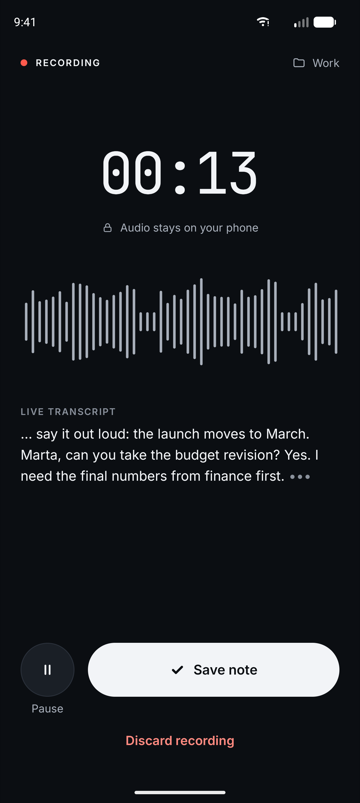
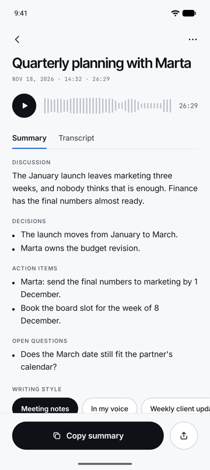
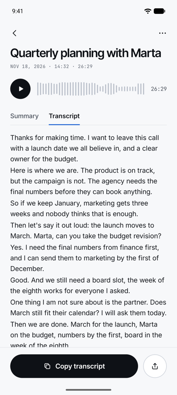
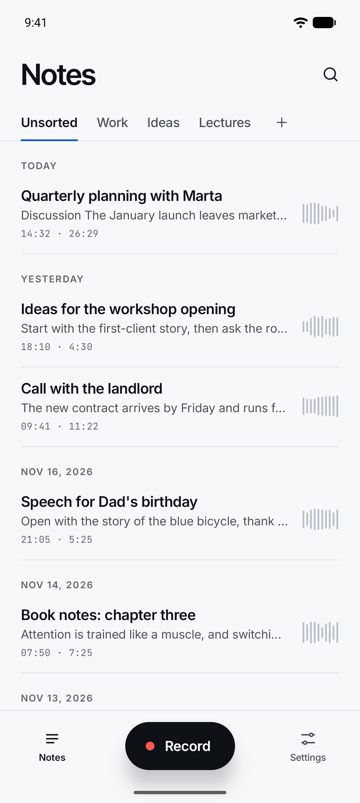
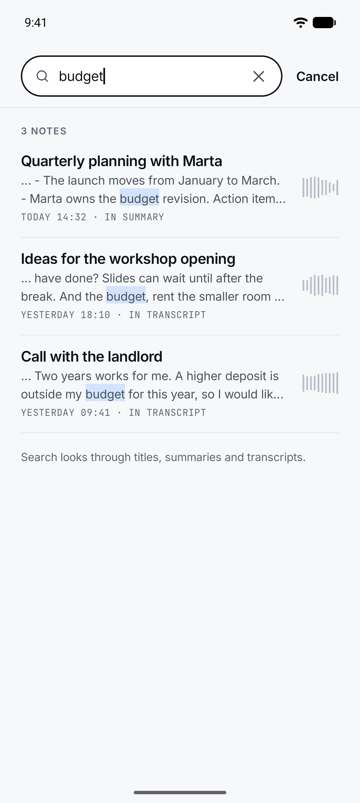
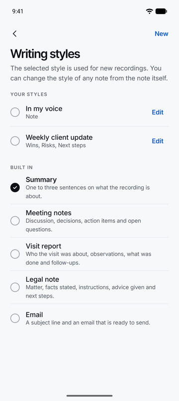
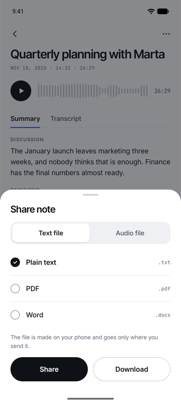
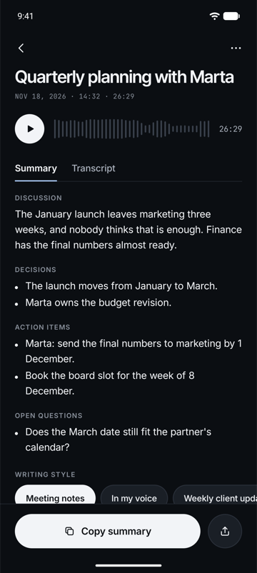

# Offhand

[](https://github.com/dmytroSamoilov/Offhand/releases)


<p><a href="https://apps.apple.com/app/offhand-private-voice-notes/id6803641617"></a>&nbsp;&nbsp;<a href="https://play.google.com/store/apps/details?id=com.dmytrosamoilov.offhand&hl=en"></a></p>

> **Latest release: [Offhand 1.5.1](https://github.com/dmytroSamoilov/Offhand/releases/latest)**:
> a new look on both platforms, every note in a Summary and a Transcript tab with time
> marks you can tap to listen, live text while you record, the Email writing style,
> transcripts on phones with 2 GB of memory and up, and a 14-day Offhand Pro trial for
> every install. See [What's new in 1.5.1](#whats-new-in-151) and the
> [releases page](https://github.com/dmytroSamoilov/Offhand/releases) for the full history.

Private voice notes with on-device AI, for Android, iPhone and iPad. Offhand records
voice memos, meetings and dictations and turns them into a transcript and a readable
note, **entirely on device**. No audio, transcript, or note ever leaves your phone.

Record → on-device speech-to-text → on-device LLM writes the note in the writing style
you picked, with an AI-generated title → stored encrypted → read, listen, search, share.

Built for anyone whose spoken thoughts are nobody else's business: executives capturing
meeting debriefs, doctors dictating patient notes, consultants and lawyers with
confidentiality obligations, or just your own ideas on a walk.

## Screenshots

<table>
  <tr>
    <td align="center"><br><sub>Your words appear as you speak</sub></td>
    <td align="center"><br><sub>A note you can act on</sub></td>
    <td align="center"><br><sub>Every word, next to the summary</sub></td>
    <td align="center"><br><sub>All your notes, sorted into folders</sub></td>
  </tr>
  <tr>
    <td align="center"><br><sub>Search says where it found it</sub></td>
    <td align="center"><br><sub>Meeting notes, an email, or your own style (Pro)</sub></td>
    <td align="center"><br><sub>Share as text, PDF or Word</sub></td>
    <td align="center"><br><sub>Light and dark</sub></td>
  </tr>
</table>

## What's new in 1.5.1

- **A new look** ("quiet ink") on Android, iPhone and iPad: a paper-grey ground,
  near-black ink, one blue for state and gold for Pro only, with the same tokens and
  components on both platforms. A bottom bar with Notes, Record and Settings replaces
  the old tab bar and floating button.
- **Summary and Transcript tabs** on every note. Each paragraph of the transcript has a
  time mark; tap it and the recording plays from that moment. The player stays pinned
  and shows the real loudness of the recording.
- **Live text while recording**: the recorder cuts a piece at every natural pause and
  the transcript appears on the record sheet as you speak. What counts as a pause
  follows the room's own noise level.
- **Writing styles**: the built-in Summary is now one to three plain sentences, a new
  **Email** style turns a memo into a subject and an email, and every note has one-tap
  style chips under its summary. Built-in headings follow the recording's language.
- **Transcripts on smaller phones**: phones with 2 to 5 GB of memory now run Offhand for
  transcripts; summaries need 6 GB. Transcription starts as soon as the speech part of
  the on-device AI is downloaded, without waiting for the rest.
- **Switches** for transcription and for the summary, so a note can be just the
  recording, or a recording with its transcript.
- **Search says where it matched** (title, summary, or the minute in the transcript),
  and several notes can be selected at once to move or delete.
- **Offhand Pro**: every install gets 14 days of Pro, with no payment details. Pro now
  also has a monthly plan, a home-screen widget that starts a recording, and Skip
  silence, which jumps over long pauses when you listen back.
- **Reliability on iOS**: a note that was waiting is finished after a relaunch, the Live
  Activity ends when the recording does, a database read on a locked device waits for
  the unlock, and background processing reports progress so the system keeps it alive.
- **Since 1.3**: video import, PDF and Word export, folder writing styles, drag-to-sort
  folders, and the free and Pro split of 1.5 (Summary, two folders and three imports
  are free).

## How it works

- **Speech-to-text**: [Whisper small (int8)](https://huggingface.co/csukuangfj/sherpa-onnx-whisper-small)
  running locally via [sherpa-onnx](https://github.com/k2-fsa/sherpa-onnx). Audio is
  transcribed in pieces *while the recording continues*, and the engine is kept warm
  while the app is in front, so the first words arrive quickly.
- **Note writing**: [Gemma 4 E2B](https://huggingface.co/litert-community/gemma-4-E2B-it-litert-lm)
  (2B effective parameters, Apache-2.0) running on device via
  [LiteRT-LM](https://github.com/google-ai-edge/LiteRT-LM), with a Tensor
  G5-optimized build selectable on Pixel 10 devices.
- **Recording**: 16 kHz PCM16 with RMS-based voice-activity detection. A piece is cut at
  the first half-second pause once it is four seconds long, measured against the room's
  noise, inside a `microphone` foreground service on Android.
- **Writing styles**: the transcript is written into the style's form. Summary is a
  short paragraph; Meeting notes, Visit report, Legal note and Email are sectioned; your
  own styles are forms built from headings, per-section guidance and a format, not free
  prompts, so the output shape stays fixed. Long recordings are written in segments
  sized to the model's 4,096-token context window and merged afterwards. Small
  on-device models truncate, miscount and bend JSON, so every step has a parser that
  recovers what it can and a fallback that never loses the transcript.
- **Device tiers**: decided once from reported memory and CPU cores. Below 6 GB the app
  downloads only the speech model and finishes notes from the transcript.
- **Checkpoints**: transcription progress is stored after every piece; an interrupted
  note resumes from the last checkpoint on the next launch or background run.
- **Encryption on Android**: notes live in a SQLCipher-encrypted Room database. The
  passphrase is random, wrapped by an AES-256-GCM key in the Android Keystore, and, on
  devices with a lockscreen, bound to user authentication (fingerprint or device
  credential via `BiometricPrompt`). Recordings are stored through Tink streaming AEAD.
- **Encryption on iOS**: the database and the recordings use the system's
  complete-unless-open data protection (`NSFileProtectionCompleteUnlessOpen`), so they
  are unreadable while the device is locked and never leave the app sandbox; backups
  use CryptoKit with the same file format as Android.
- **UI**: Jetpack Compose with Material 3 adaptive layouts on Android (one pane on
  phones, list-detail two-pane on tablets and unfolded foldables); SwiftUI on iOS. Both
  follow one design system with the same token and component names. The domain, data
  and ViewModel layers are shared Kotlin Multiplatform code, so both apps run the same
  pipeline, parsers and business rules.

## Verify the privacy claims yourself

That is the point of this repo being public:

- **Your notes never leave your phone.** Nothing in the codebase uploads a recording, a
  transcript or a note. The network is used for three things: the one-time model
  download over HTTPS
  ([`ModelDownloader.kt`](core/ai-local/src/main/kotlin/com/dmytrosamoilov/offhand/core/ai/local/ModelDownloader.kt)
  on Android,
  [`IosFileDownloader.kt`](shared-framework/src/iosMain/kotlin/com/dmytrosamoilov/offhand/shared/IosFileDownloader.kt)
  on iOS), purchases through the stores, and the anonymous usage numbers described
  next.
- **Anonymous usage and crash reports, with a switch.** New installs in the EU are asked
  on the first screen; elsewhere sharing is on from the first launch. Either way it is
  one switch in Settings, "Share anonymous usage". Firebase never initialises on its
  own: the provider is removed from the [manifest](app/src/main/AndroidManifest.xml) and
  Crashlytics and Analytics are only configured while the stored answer says so, in
  [`TelemetryController.kt`](app/src/main/java/com/dmytrosamoilov/offhand/telemetry/TelemetryController.kt)
  and [`TelemetryController.swift`](iosApp/Offhand/Telemetry/TelemetryController.swift).
  Events never contain note content, titles, folder names, search queries or the names
  of your own styles; the full list is in
  [`AnalyticsEvents.kt`](core/data/src/commonMain/kotlin/com/dmytrosamoilov/offhand/core/data/domain/analytics/AnalyticsEvents.kt).
- **Encryption at rest**: SQLCipher database and Keystore-wrapped keys in
  [`core/security`](core/security) and [`core/data`](core/data); file protection on iOS
  in the same modules' `iosMain` sources.
- **Backups are yours**: `allowBackup="false"` keeps notes out of Android cloud
  backups; the only backup is the passphrase-encrypted file you export yourself
  ([`feature/backup`](feature/backup)). Screenshots and screen recording are allowed.
- **Payments stay with the stores**: Play Billing and StoreKit 2 are called directly
  ([`PlayProStore.kt`](core/data/src/androidMain/kotlin/com/dmytrosamoilov/offhand/core/data/billing/PlayProStore.kt),
  [`StoreKitProStore.swift`](iosApp/Offhand/Store/StoreKitProStore.swift)); there is no
  third-party billing SDK, no account and no server that learns what you bought.

## Requirements

- Android 12+ (minSdk 31) with 4+ CPU cores, checked at first launch. Phones sold with
  **2 to 5 GB of memory** get transcripts; **6 GB or more** adds summaries and writing
  styles
- iPhone or iPad on iOS 18 or later, with the same memory tiers
- About 3 GB of free storage for the one-time downloads (Whisper + Gemma), or about
  400 MB on a transcripts-only phone

## Building

Four product flavors that install side by side: `production` (`com.dmytrosamoilov.offhand`),
`dev` (`com.dmytrosamoilov.offhand.dev`, "Offhand Dev" label), `uitest`
(`com.dmytrosamoilov.offhand.uitest`, "Offhand UI Test") and `devicetest`
(`com.dmytrosamoilov.offhand.devicetest`, "Offhand Device Test"); the last two are for
[Testing](#testing).

1. Clone and open in Android Studio (or use `./gradlew assembleDevDebug`). The models
   (Whisper + Gemma) are ungated on Hugging Face — no account or token needed; the app
   downloads them on first run.
2. Optional: Firebase telemetry (crash reporting and anonymous usage) needs your own
   Firebase project's `google-services.json` in `app/`. The app builds and runs fine
   without it.

```
./gradlew assembleDebug testAndroidHostTest testDebugUnitTest lintAndroidMain lintDebug :app:lintDevDebug
```

### iOS

The iOS app lives in `iosApp/` and links the shared Kotlin code as an XCFramework.
Schemes mirror the Android flavors: `Offhand-dev`, `Offhand-prod`, `Offhand-uitest` and
`Offhand-devicetest`.

1. Install [XcodeGen](https://github.com/yonaskolb/XcodeGen) and Git LFS, then build the
   shared framework and fetch the speech-to-text frameworks:

   ```
   ./gradlew :shared-framework:assembleOffhandSharedReleaseXCFramework
   iosApp/Tools/fetch-frameworks.sh
   ```

2. Generate the project and build:

   ```
   cd iosApp && xcodegen generate
   GIT_LFS_SKIP_SMUDGE=1 xcodebuild build -project Offhand.xcodeproj -scheme Offhand-dev \
     -destination 'generic/platform=iOS Simulator' ARCHS=arm64
   ```

   `GIT_LFS_SKIP_SMUDGE=1` is needed for a fresh package checkout: LiteRT-LM keeps
   prebuilt libraries in Git LFS next to its sources and the iOS binary comes from a
   release archive instead, so the LFS files are left as pointers.

3. Optional — Firebase telemetry needs your own `GoogleService-Info.plist` under
   `iosApp/Firebase/dev/` or `iosApp/Firebase/prod/`; without it the build warns and
   telemetry stays off.

## Testing

### Unit tests

```
./gradlew testAndroidHostTest testDebugUnitTest
```

`testAndroidHostTest` runs the JVM tests of the Kotlin Multiplatform modules (`commonTest`
and `src/androidHostTest`), `testDebugUnitTest` those of the plain Android modules.

Tests that need no Android or MockK live in `commonTest` and also run on the
Kotlin/Native iOS target, which catches K/N-only differences (regex classes, stdlib)
that the JVM run cannot:

```
./gradlew :core:ai-api:iosSimulatorArm64Test :core:audio:iosSimulatorArm64Test \
  :core:common:iosSimulatorArm64Test :core:device:iosSimulatorArm64Test \
  :feature:notes:iosSimulatorArm64Test :feature:recording:iosSimulatorArm64Test
```

### Smoke tests (Maestro)

The `uitest` flavor (Android) and the `Offhand-uitest` scheme (iOS) are the normal app
with the AI swapped for fakes from `:testing:fakes`: the model manager reports the model
as downloaded, speech-to-text returns canned sentences, the note structurer returns a
fixed note titled "Smoke test note", and the microphone is a tone generator. So the
whole record → note flow runs on any emulator or simulator, with no 2.4 GB download,
no real audio, and no device gate. Nothing else is faked — onboarding, the encrypted
database, the recording pipeline, list, search and detail are all real.

The [Maestro](https://maestro.mobile.dev) flows in `.maestro/` drive both platforms.
`.maestro/config.yaml` fixes their order, because every flow after the first opens the
note it creates. Twenty flows cover:

1. Onboarding with the anonymous-usage question, the first recording, search and the note
2. Folders: create, folder writing style, move, filter, rename, delete
3. Backup and restore through the system file picker, with the passphrase
4. A writing style built by hand, and one drafted from a plain-text description (4, 5)
5. Audio import and video import through the system picker (6, 15)
6. Smart suggestions handed to the system calendar editor (7)
7. The paywall and every Pro gate as a free user, through the debug override (8, 14)
8. Recording into a folder, pause, resume and discard (9, 11)
9. Note actions: edit, copy, playback, restyle, re-transcribe, delete (10, 12, 17)
10. Sharing as text, PDF, Word and audio (13)
11. Settings and About & support, including removing and re-downloading the on-device AI (16)
12. Onboarding branches, a recording made without the on-device AI, and a transcripts-only phone (18, 19, 20)

`.maestro/lock/` holds the app-lock flow, which runs separately because it needs a
screen lock on the device.

The flows assume a phone-sized screen; on tablets and unfolded foldables the app switches
to its two-pane layout and the steps no longer line up.

Not covered with the fakes: a failed or interrupted recording, the download banner,
share-sheet intake, the widget, the Live Activity, the real review prompt, other
languages, and model quality.

**Install Maestro** (the plain `maestro` formula is an unrelated app — use the tap):

```
brew trust mobile-dev-inc/tap && brew install mobile-dev-inc/tap/maestro
```

**Android**, with an emulator running or a device connected:

```
./gradlew assembleUitestDebug
adb install -r app/build/outputs/apk/uitest/debug/app-uitest-debug.apk
adb push .maestro/assets/import-sample.m4a /sdcard/Download/import-sample.m4a
adb push .maestro/assets/import-sample.mp4 /sdcard/Download/import-sample.mp4
maestro test .maestro/
```

**iOS**, with a booted simulator: build the `Offhand-uitest` scheme (Xcode, or
`xcodebuild -scheme Offhand-uitest -destination 'id=<simulator udid>'`), install the
`.app` with `xcrun simctl install booted <path>`, then:

```
xcrun simctl privacy booted grant microphone com.dmytrosamoilov.offhand.uitest
maestro test .maestro/
```

With several devices connected, add `--device <id>` before `test`. A failed run leaves
screenshots and a UI hierarchy dump under `~/.maestro/tests/<timestamp>/`.

The import flows on iOS need both samples from `.maestro/assets/` in the simulator's
"On My iPhone" storage; `.github/workflows/ci.yml` shows how they are copied there.

### On-device suite (real models)

A second suite runs on a real phone or tablet with the real Whisper and Gemma. The Mac
plays a fixture clip from `testing/device-suite/clips/` through its speakers, the app
records it, and the transcript's word error rate and the summary are scored against the
fixture into `testing/device-suite/results/device-results.jsonl`.

```
testing/device-suite/run-android.sh
testing/device-suite/run-ios.sh --device <udid>
```

Android drives the `devicetest` flavor with the Maestro flows in `.maestro/device/`.
iOS and iPadOS use an XCUITest (`iosApp/DeviceTests`, scheme `Offhand-devicetest`),
because Maestro does not drive real iOS devices. Put the device next to the speakers
in a quiet room, unlocked, with the on-device AI already downloaded.

### Continuous integration

`.github/workflows/ci.yml` runs on every push and pull request: Android build, unit
tests and lint; the shared tests on the iOS simulator target; and the smoke flow on an
Android emulator (Ubuntu, KVM) and on an iOS simulator (macOS). Maestro artifacts are
attached to failed runs.

## Architecture

Multi-module, convention-plugin based. Features depend on abstractions, never
implementations:

```
:app                    thin shell: activity, navigation, DI bindings
:core:common            BaseViewModel, shared primitives
:core:designsystem      design tokens, fonts and the component kit
:core:ui                screen scaffolding (loading/error handling)
:core:device            device tiers by memory and CPU cores
:core:audio             recording, VAD chunking, waveforms, silence detection
:core:ai-api            AI abstractions — no LiteRT dependency
:core:ai-local          LiteRT-LM engine, Whisper STT, model download, catalog
:core:security          Keystore passphrase wrapping, encrypted audio store, app lock
:core:data              encrypted Room notes, folders, checkpoints, Pro status, billing, analytics events
:feature:onboarding     usage question (EU), device check, first recording
:feature:recording      record sheet, foreground service, AI pipeline, writing styles, suggestions, widget
:feature:notes          list / search / folders / detail / edit, export to text, PDF and DOCX
:feature:settings       writing styles, switches, backup, import, subscription, privacy
:feature:backup         passphrase-encrypted backup and restore of notes, folders, styles and audio
:feature:paywall        Offhand Pro paywall and purchase flow
:shared-framework       Kotlin Multiplatform framework consumed by the iOS app
:testing:fakes          canned AI, model, device, microphone and store for smoke tests
```

Three layers inside each feature (domain → data → presentation), use cases wrapping
repositories, StateFlow-only ViewModels, mappers between domain and UI models. Feature
and core modules are Kotlin Multiplatform: `commonMain` holds the logic, `androidMain`
the Compose UI and Android services, `iosMain` the platform bridges the SwiftUI app
calls through `shared-framework`.

## License

The source code is licensed under [GPL-3.0](LICENSE) © Dmytro Samoilov. Third-party
components and AI models are listed in [THIRD-PARTY-NOTICES.md](THIRD-PARTY-NOTICES.md).

Offhand is open source but **not open contribution** — pull requests are not accepted;
issues and bug reports are welcome. See [CONTRIBUTING.md](CONTRIBUTING.md) for why.

The **Offhand** name and logo are not covered by the code license and may not be used for
derivative apps or forks without permission.

Legal documents for the published app:
[Privacy Policy](https://dmytrosamoilov.com/offhand/privacy-policy/) · [Terms & Conditions](https://dmytrosamoilov.com/offhand/terms-and-conditions/)
